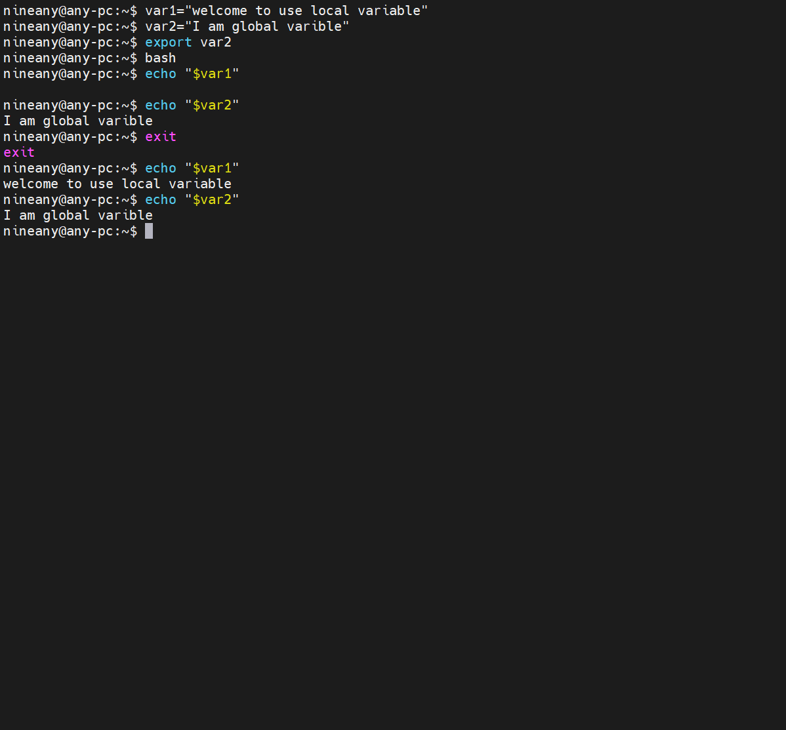
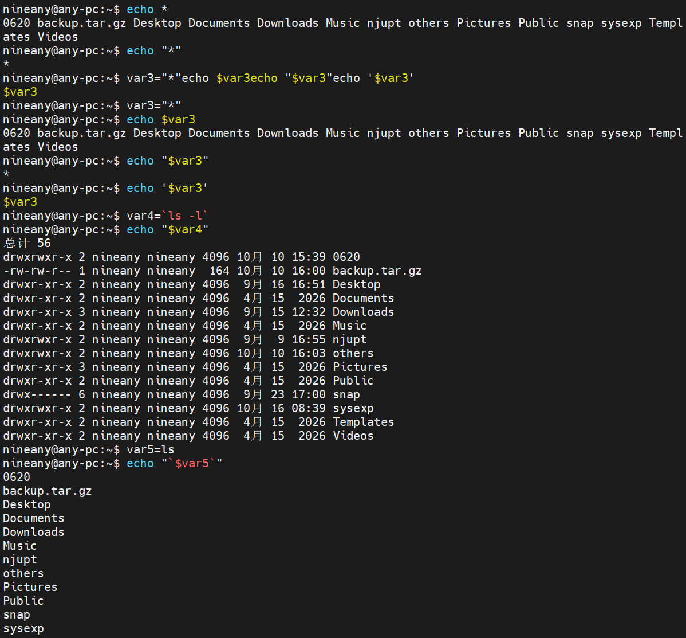
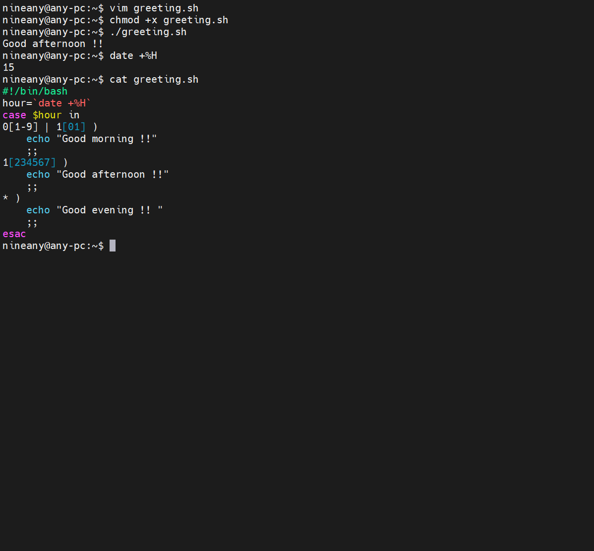
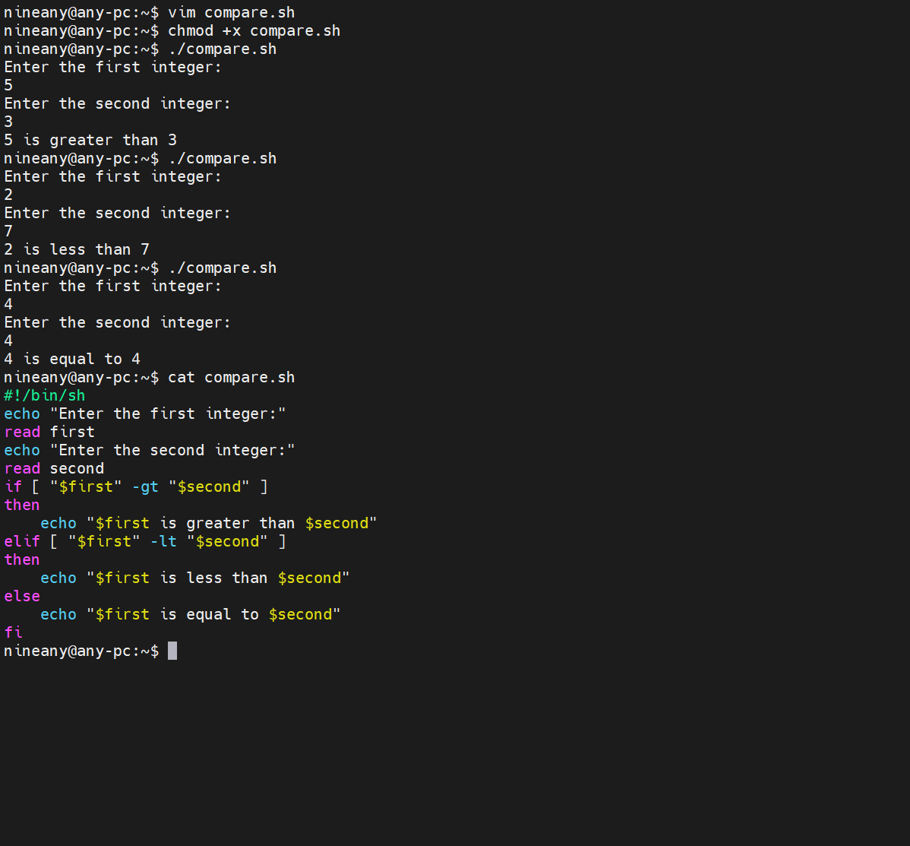
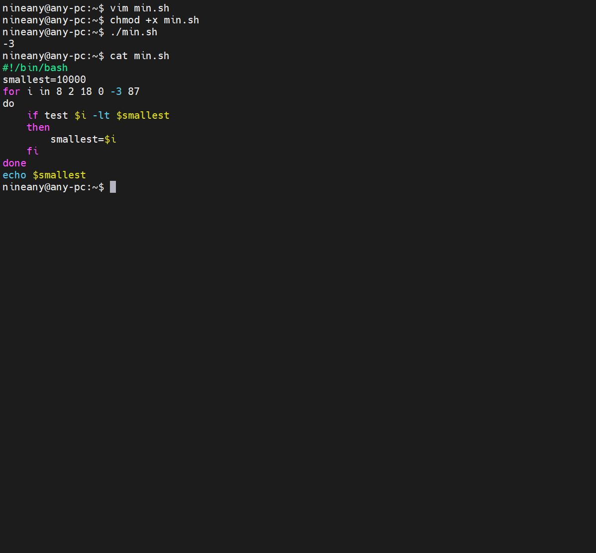
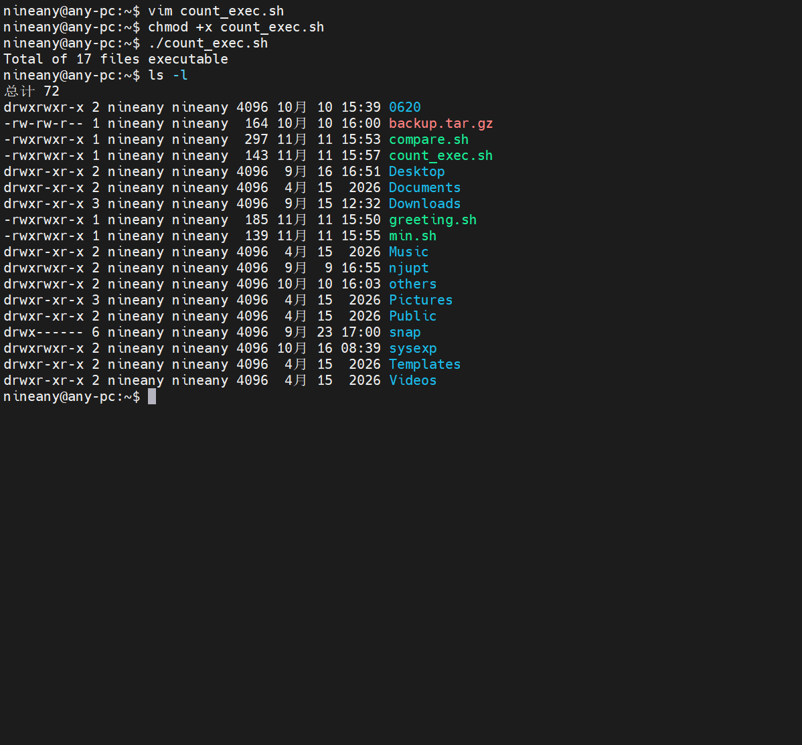
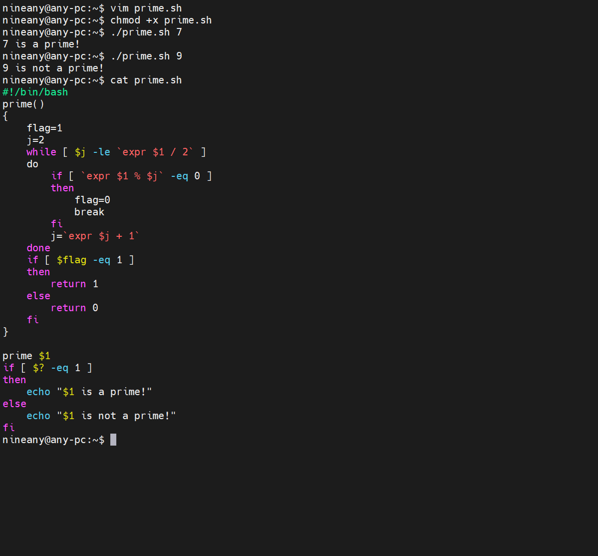

# 第二次实验
## Part1 局部变量和环境变量

>子bash中var1不显示、var2显示，说明局部变量不被子shell继承，export输出的环境变量可以继承

## Part2 引号的作用

>双引号内变量会替换但通配符不展开，单引号内完全是字面字符，反引号表示命令替换

## Part3 shell程序设计
- 获得系统时间，判断是上午、下午还是晚上（case语句）

>修正了指导书笔误：hour赋值等号两侧不能有空格，morining改为morning；当前15点，输出Good afternoon符合预期

- 输入两个数，比较它们的大小（if语句）

>指导书中`$FIRST`为笔误，变量名区分大小写，已改为`$first`；分别测试了大于、小于、等于三种情况

- 从若干数中寻找最小值（for循环）

- 计算当前目录下可执行文件的个数

>test -x对目录也成立（目录的x权限表示可进入），因此统计的17个可执行文件中包含13个目录，与ls -l结果一致

- 将判断一个数是否是素数写成一个函数，并进行调用

>函数通过`$1`接收参数，返回值由`$?`获取；7是素数，9能被3整除不是素数，结果均正确
