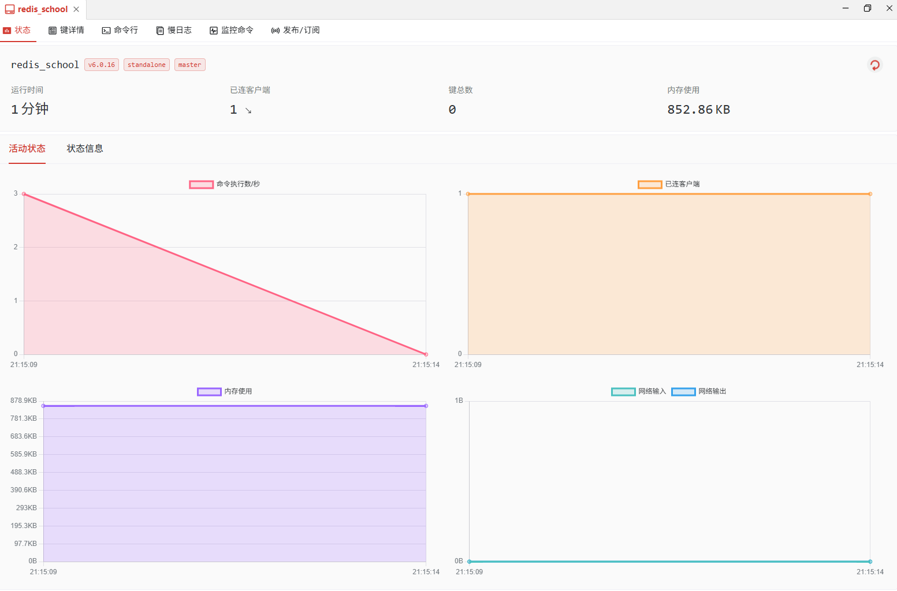

# 第四次作业
## 连接前准备
第一步: sudo apt install redis-server第二步: sudo vim /etc/redis/redis.conf
第二步：找到bind 127.0.0.1,改为:bind 0.0.0.0
第三步：找到# requirepass，去掉#并设置密码:requirepass 123456
>注意这里用`/`去查找会更快
第三步: sudo systemctl restart redis-server
## 连接
这里用的`Tiny RDM`
>写好虚拟机ip和密码即可
